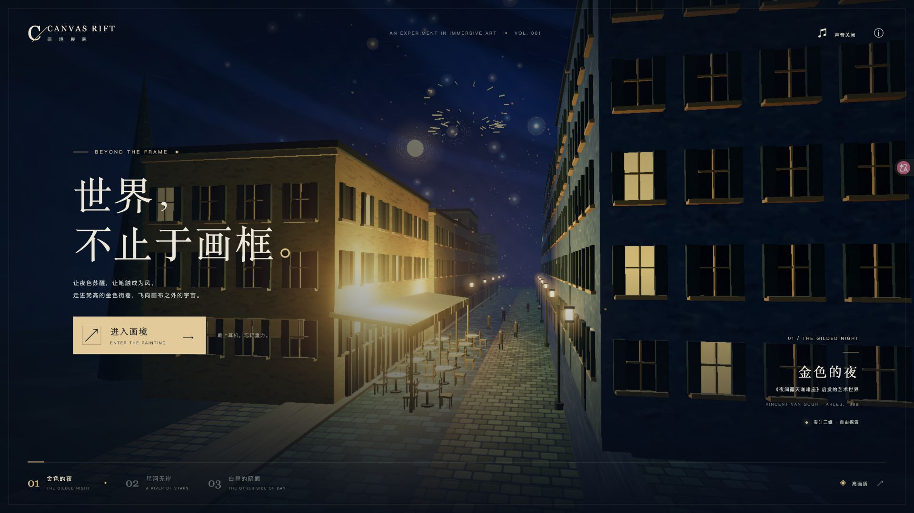
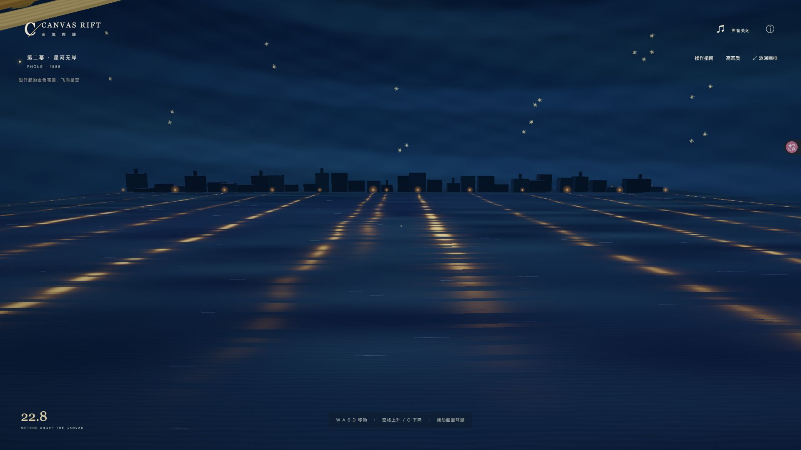
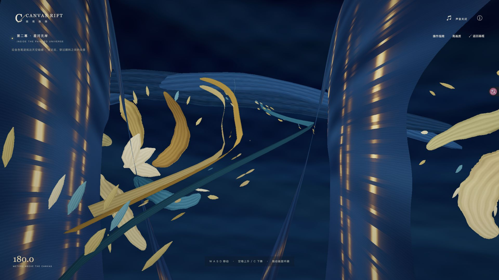
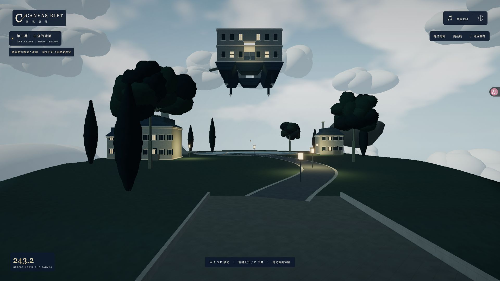
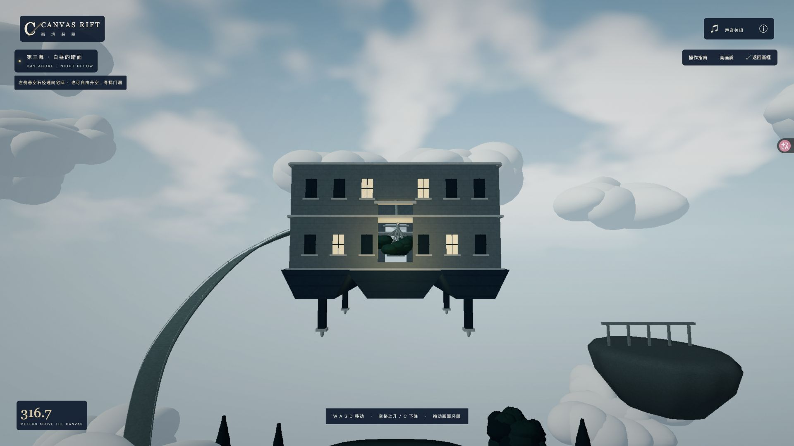

# Canvas Rift · 画境裂隙

**简体中文** · [English](README.en.md)

**走进画中的街巷，飞向画布之外的宇宙。**

画框是一道门。Canvas Rift 是一个可在浏览器中自由探索的三维艺术世界：从梵高的金色咖啡座出发，掠过罗讷河的星光与倒影，再穿越天空裂缝，抵达白昼与黑夜共存的超现实夜园。

三幕已经实现，并通过连续的空间与镜头连接。你可以走近桌椅、飞越屋顶、穿行星体笔触，也可以进入倒悬宅邸，寻找绘画中不可能存在的空间。项目以 **TypeScript + Three.js + Vite** 构建，场景在浏览器中实时渲染。

[观看视频](docs/canvas-rift-demo.mp4) · [三幕旅程](#三幕旅程) · [快速开始](#快速开始) · [操作方式](#操作方式)

## 实机演示

**[▶ 观看完整三幕演示（MP4，约 63 秒）](docs/canvas-rift-demo.mp4)**

实机录制展示从点击「进入画境」、沿街抵达河岸、循笔迹升空，到穿过裂缝进入夜园与倒悬宅邸的完整旅程。点击上方链接打开视频；三幕截图与探索内容见下方。

## 体验亮点

- **从看画到入画**：开场保留画框构图，点击进入后，镜头推进、灯光与笔触苏醒，随后交还自由控制。
- **自由飞行与连续穿越**：从街巷一路飞向河岸、星空和夜园；建筑与地面具有碰撞边界，星体笔触可以从内部穿行。
- **绘画成为空间**：程序化画布纹理、流动的颜料水面与有厚度的立体笔触，保留蓝金色彩、光屑与绘画质感。
- **昼夜与重力的奇观**：在白昼天空下探索夜色花园，飞入倒悬宅邸，靠近悖论灯观察局部昼夜变化。
- **自行探索或自动游览**：支持桌面与触屏控制，提供约 60 秒的自动运镜、高画质与轻量档，以及可选环境音。

## 三幕旅程

三幕分别从街巷、河面与星空，走向原创的超现实世界。以下保留五张 **1920×1080 完整视口实机截图**，呈现沿途的主要构图与空间变化。

### 01 · 金色的夜

受梵高《夜间露天咖啡座》启发。金色雨棚、深蓝街巷、暖灯与橄榄绿窗板构成旅程的起点；桌椅、建筑和路灯拥有真实的空间层次，画布纹理与漂浮笔触贯穿其中。

点击「进入画境」，从开场的固定构图走进街区。你可以在桌椅之间漫游，沿着街灯前行，也可以升到屋顶，靠近那些游离于建筑之外的笔触。



### 02 · 星河无岸

受梵高《罗讷河上的星夜》启发。街巷尽头通向深蓝的罗讷河岸，暖色岸灯在水面留下断续的金色长倒影。可以贴近河面低空掠过，观察流动的颜料笔触，也可以回望刚刚离开的街区。



循升起的金色笔迹继续飞行，远处的星光逐渐成为有厚度的立体笔触。河面随高度折起，展开为巨大的绘画空间；你可以穿行星体与碎笔之间，从新的角度观看同一片夜色。



### 03 · 白昼的暗面

受马格利特《光之帝国》启发的原创超现实世界。天空深处的细缝展开为可穿越的三维开口，另一侧是明亮的白昼天幕；悬空花园、住宅与树木却笼罩在夜色中，弯曲灯路引向远处。



升空后，倒悬宅邸逐渐显露。你可以自由寻找开放门洞，也可以沿左侧悬空石径抵达后门，进入回廊与中庭：树冠从天花板向下生长，家具倒置，白昼井贯通上下。



夜园中还藏着改变光影规则的悖论灯。靠近时，脚下渐显白昼，头顶的云层却进入夜色；离开后，环境重新恢复原来的昼夜关系。

### 探索路线

**咖啡座街巷 → 罗讷河岸 → 厚笔触星河 → 天空裂缝 → 悬空夜园 → 倒悬宅邸**

沿街灯抵达河岸后，循金色笔迹升空，在约 243 米高度接近裂缝中心并穿过开口。进入夜园后可沿灯路探索，再升向宅邸门洞。页面中的路线提示会随所在空间变化；探索中可以沿原路返回，也可以点击「返回画框」回到开场。

## 快速开始

需要 **Node.js 22.18+**、npm 和支持 **WebGL 2** 的现代浏览器。

```sh
npm ci
npm run dev
```

打开终端显示的地址（默认 `http://127.0.0.1:5173/`；端口占用时以终端输出为准），点击「进入画境」开始探索。项目无需 API 密钥或后端服务。

### 自动游览

在运行地址后加 `?tour=1`，例如 `http://127.0.0.1:5173/?tour=1`。点击「进入画境」后，镜头会连续游览三幕约 60 秒，使用 16:9 高画质构图，隐藏操作界面并保留章节标题，结束后停留在中庭尾帧。

`Esc` 暂停或继续，`R` 重置并等待再次点击，`Home` 返回画框。页面隐藏时自动暂停，恢复可见后接续播放；录制演示时可先完整播放一轮预热场景，再按 `R` 回到开场。

## 操作方式

| 操作 | 桌面控制 |
| --- | --- |
| 前后 / 横移 | `W A S D` 或方向键 |
| 上升 / 下降 | `空格` / `C`，也可使用 `E` / `Q` |
| 加速 | 按住 `Shift` |
| 环顾 | 按住画面拖动；支持的浏览器可双击锁定鼠标 |
| 暂停 / 释放鼠标 | `Esc` |
| 查看操作提示 | 点击「操作指南」 |
| 回到开场 | 点击「返回画框」 |

移动带有惯性，前进方向会随视角改变。触屏使用底部方向与 `＋ / −` 按钮长按移动、升降，拖动画面环顾。环境音默认关闭，可通过声音按钮开启。

**高画质**保留辉光与更丰富的笔触、云层细节；**轻量画质**关闭辉光并减少部分细节，适合更轻的渲染负载。窄屏默认采用轻量档，探索时也可手动切换。

## 技术与创作

| 组成 | 实现方式 |
| --- | --- |
| 三维世界 | Three.js 实时渲染，共享场景、相机与连续飞行控制 |
| 绘画质感 | 程序化画布纹理、颜料 Shader、立体厚笔触与画布后期 |
| 空间裂缝 | 绘制另一侧真实三维几何，镜头连续穿过开口 |
| 场景细节 | 重复笔触与植被实例化，几何和纹理共享，提供两档画质 |
| 环境音 | Web Audio 本地合成，随所在区域变化，按需开启 |

第一、二幕以梵高作品的色彩与意象展开三维再创作；第三幕延续马格利特的昼夜悖论，构建原创的悬空夜园与倒悬建筑。

## 已知问题

从裂缝上部（约 260–263 米）返回第二幕时，位置可能发生跳动；约 243 米的中心路线往返正常。自由探索时建议从开口中心穿过。

## 开发

```sh
npm run check    # 类型检查
npm test         # 回归测试
npm run build    # 生产构建
npm run preview  # 预览生产构建
```

## 开源协议与素材

项目原创源代码及配套代码文档采用 [MIT License](LICENSE)，版权所有 © 2026 perseverance-geek。

项目原创截图与演示视频保留权利，不纳入 MIT 授权范围；除适用法律允许的使用外，其他使用需另行取得许可。第三方艺术作品、素材及依赖仍遵守各自的版权与授权要求，本项目的 MIT License 不授予这些第三方内容的权利。
